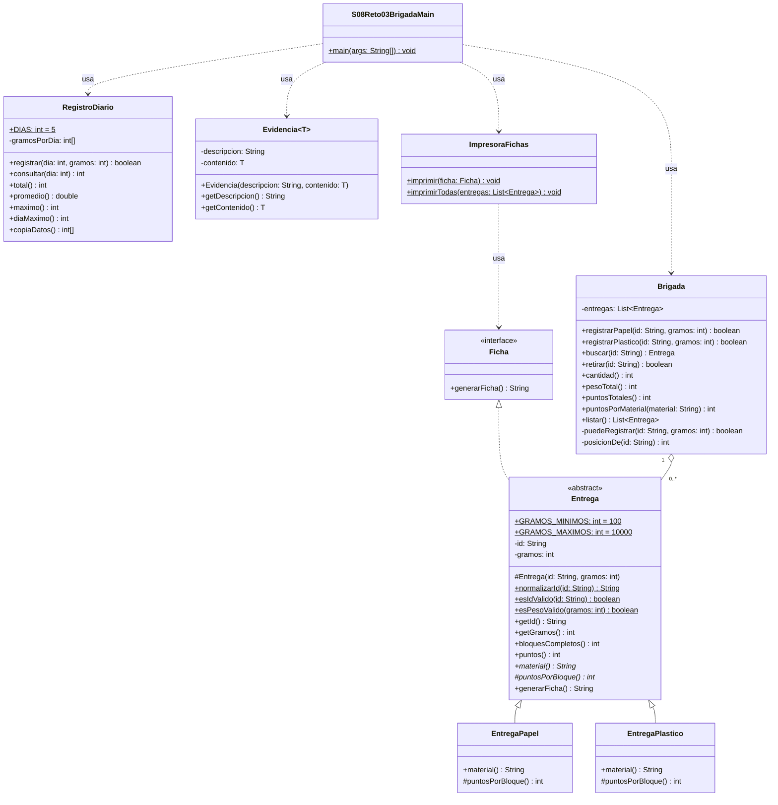

# Solución · Reto 3 · Brigada de reciclaje escolar

## Integrantes y aportes

| Integrante | Aporte |
| --- | --- |
| _andres rueda_ | _identificacion del problema_ |
| _crisbely_ | _grafico uml_ |
| _andres alvaro_ | _identificacion del problema_ |
| _andres jimenez_ | _codigo_ |
| _ricardo vargas_ | _codigo,grafico uml_ |

## Identificación del problema

- **¿Quién la necesita?** La brigada de reciclaje del colegio que recibe papel y plástico.
- **Dificultad:** registrar entregas sin duplicarlas, calcular puntos distintos por material y retirar registros cargados por error sin que sigan sumando.
- **Debe resolver:** registrar, buscar, retirar y listar entregas; totales de la lista actual; estadísticas de cinco días; evidencias de resultado.
- **Queda fuera:** pagos, conversión de puntos a dinero, persistencia, interfaz gráfica.

**Entradas:** ID de entrega, material, gramos; gramos por día (5 días).
**Salidas:** comprobantes (ID, material, gramos, puntos), cantidad, peso total, puntos totales, estadísticas diarias, evidencias.

**Reglas:**
1. ID obligatorio, normalizado con `strip()` + `toUpperCase(Locale.ROOT)` al registrar y al buscar; no se repite.
2. Peso de entrega entre 100 y 10000 g.
3. Papel: 1 punto por cada 100 g completos; plástico: 2 puntos. El sobrante no suma.
4. Los totales se calculan sobre la lista actual (una entrega retirada no cuenta).
5. Gramos diarios entre 0 y 100000; día válido 1–5; máximo empatado → primer día.

## UML inicial

El diseño inicial no cambió durante la implementación (ver UML final).

## UML final



## Decisiones de diseño

- **«Es un»:** `EntregaPapel` y `EntregaPlastico` *son* entregas; solo varía el material y los puntos por bloque, así que la base abstracta concentra ID, gramos y el cálculo `bloques × puntosPorBloque()`. No hay `if` por subtipo: cada subclase responde con su propia implementación.
- **«Usa»:** `Brigada` *usa* (contiene) entregas; `ImpresoraFichas` *usa* el contrato `Ficha` sin conocer las subclases.
- **Interfaz `Ficha`:** contrato pequeño para producir el comprobante; `Entrega` la implementa y la impresora la recibe.
- **Arreglo `int[5]`** en `RegistroDiario`: son exactamente cinco datos fijos y el índice representa el día (día − 1). No se ordena.
- **`List<Entrega>` con `ArrayList<>`:** la cantidad de entregas varía, se necesita orden de registro y acceso por índice al buscar/retirar; `ArrayList` es la opción simple y eficiente para eso. `listar()` devuelve `List.copyOf(...)`, no modificable.
- **`Evidencia<T>`:** clase genérica propia usada como `Evidencia<Integer>` (puntos vigentes) y `Evidencia<String>` (conclusión), sin casts ni tipos raw.
- **Validación antes de cambiar estado:** `Brigada` valida ID, peso y duplicado antes de crear la entrega; `RegistroDiario` valida día y gramos antes de escribir. Todas las acciones devuelven `boolean`.
- Los totales se recorren en cada consulta: no hay acumuladores históricos.

## Ejecución

- Paquete: `s08reto03` (fuentes en `labs/reto-03-brigada-reciclaje/src`, marcada como *Sources Root* en el módulo).
- Main: `s08reto03.S08Reto03BrigadaMain`.
- Desde terminal (en la carpeta del reto):

```bash
javac -d out src/s08reto03/*.java
java -cp out s08reto03.S08Reto03BrigadaMain
```

## Pruebas

| # | Entradas | Esperado | Obtenido | ¿Coincide? |
| --- | --- | --- | --- | --- |
| 1 | Papel R-01 750 g, plástico R-02 450 g | 2 entregas, 1200 g, 15 pts (7 + 8) | 2, 1200 g, 15 (7 + 8) | Sí |
| 2 | Retirar R-01 | aceptado; 1, 450 g, 8 pts | true; 1, 450 g, 8 | Sí |
| 3 | Retirar R-01 otra vez | rechazado; 1, 450 g, 8 pts | false; 1, 450 g, 8 | Sí |
| 4 | Evidencia numérica final | 8 | 8 | Sí |
| 5 | Buscar `" r-02 "` | encuentra R-02 | R-02 Plastico 450 g 8 pts | Sí |
| 6 | Buscar R-01 (retirado) / Z-99 | No encontrado | No encontrado | Sí |
| 7 | Días `[1200, 800, 0, 2000, 1000]` | 5000 g, 1000.0 g, máx 2000, día 4 | 5000, 1000.0, 2000, día 4 | Sí |
| 8 | Corregir día 6 / día 0 / 100001 g; consultar día 7 | rechazados, arreglo sin cambios | false ×3, «Posicion inexistente», arreglo igual | Sí |
| 9 | Empate 3000 en días 2 y 5 | día 2 | día 2 | Sí |
| 10 | Papel 99 g, plástico 10001 g | rechazados, lista vacía | false, false; 0 / 0 / 0 | Sí |
| 11 | Papel 100 g (ejecución nueva) | aceptado, 1 pt | true, 1 pt | Sí |
| 12 | Plástico 100 g (ejecución nueva) | aceptado, 2 pts | true, 2 pts | Sí |
| 13 | Papel 10000 g (ejecución nueva) | aceptado, 100 pts | true, 100 pts | Sí |
| 14 | `a-10` y luego `"  A-10 "` | duplicado rechazado | true, false | Sí |
| 15 | ID en blanco / null | rechazados | false, false | Sí |
| 16 | Retirar Z-99 inexistente | rechazado, lista conservada | false; 1 entrega, 300 g | Sí |
| 17 | Brigada nueva | 0 entregas, 0 g, 0 pts | 0, 0, 0 | Sí |

## Breakpoint

Se colocó un breakpoint en `Entrega.puntos()` al registrar el plástico R-02 (450 g). Antes de la línea, `gramos = 450`; tras evaluar `bloquesCompletos()` se observó `450 / 100 = 4` (la división entera descarta los 50 g sobrantes) y `puntosPorBloque()` despachado a `EntregaPlastico` devolvió `2`, por lo que el resultado fue `8`.
